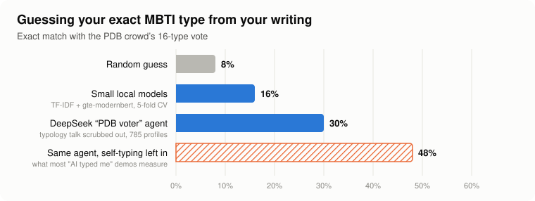
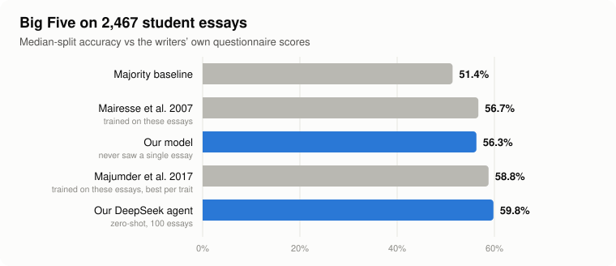
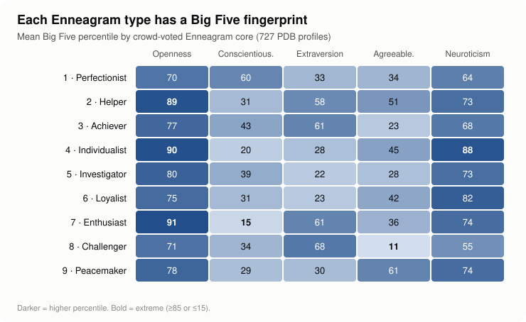
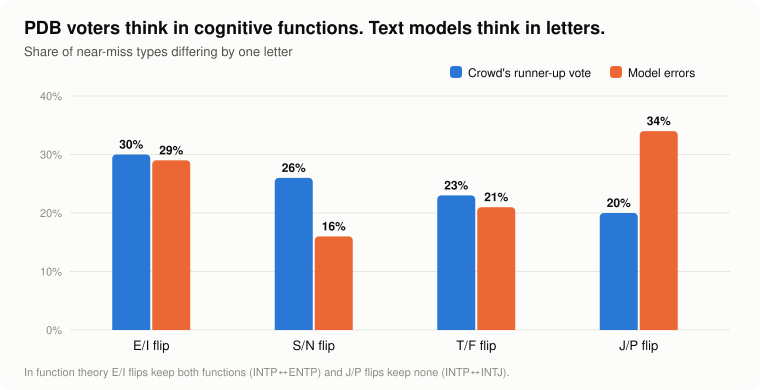
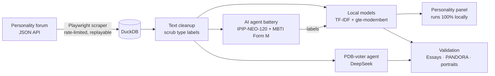

# What does your writing say about your personality? 🧠

**I scraped 1,000+ self-descriptions from a personality-typing forum, ran an AI "psych lab" on them, and trained models that read your MBTI, Big Five and Enneagram from text.** Then I tested them against real people, published research and commercial personality tests.

The models learned from internet strangers typing each other, and still went toe to toe with models from academic papers.


---

## ⚡ Highlights

- 🎯 **An AI agent that types you like a forum veteran:** **30% exact MBTI type** (random guessing: 8%) across 785 profiles, with every type label scrubbed from the text first.
- 📝 **Big Five that beats published research:** zero-shot, the agent hits **59.8%** on the classic Essays benchmark. The best published model trained on that dataset: 58.8%. The local model never saw an essay and still lands within half a point of a 2007 model trained on them.
- 🕵️ **Caught the shortcut most "AI typed me" demos take:** leave people's own "I'm an INFJ" in the text and accuracy jumps **12 points**. Scrub it and you see what the AI can actually read.
- 🌀 **The forum thinks in Jungian functions, AI thinks in letters:** voters treat INTP and ENTP as close cousins; models confuse INTP with INTJ.
- 🔢 **Enneagram from a Big Five test:** a model I built from forum data names your core Enneagram type **38%** of the time and has it in its top three **72%** of the time (chance: 11% and 33%), on par with dedicated Enneagram tests in the only independent comparison I found.
- 🧬 **Every Enneagram type has a Big Five fingerprint,** and the infamous "countertype" subtypes show up in the data exactly where the theory says they should.

---

## 📊 The results

### Reading your MBTI type from how you write



The agent reads a profile the way an experienced voter on the forum would: it figures out the dominant and auxiliary cognitive functions, then commits to a type with probabilities for all 16. Small local models trained on the same data reach 16%, and a version that leaves self-typing in reaches 48%, which is why scrubbing matters.

### Big Five that holds up against real questionnaires



The Essays dataset (Pennebaker & King) pairs 2,467 student essays with each writer's own personality questionnaire. Published models were **trained on it**. Mine was trained only on forum self-descriptions and was never shown a single essay.

### Each Enneagram type has a Big Five fingerprint



Every type lands where its textbook description says it should: 8s are the most assertive and least vulnerable (assertiveness d = +1.5), 7s chase excitement and skip the discipline, 4s run highest in Neuroticism, 1s are the most conscientious, 9s the most agreeable. The full breakdown, including all **27 instinctual subtypes**, is in the [Enneagram report](docs/results/2026-10-25-enneagram-report.md).

### The crowd uses cognitive functions. The models don't.



When forum voters split on a type, the runner-up is usually the E/I mirror (same functions, different order). That's Jungian function theory showing up in thousands of votes. Text models make the opposite mistake and confuse J/P, the one letter that changes every function.

---

## 🔬 More findings

| Finding | Number |
|---|---|
| Profiles that talk about typology (the hidden label) | **755 of ~1,000** |
| MBTI ↔ Enneagram link on the forum (Cramér's V) | **.48**, replicated on Reddit self-reports (.37) |
| Big Five → Enneagram core, top-3 hit rate | **72%** (chance 33%) |
| AI agents answering MBTI Form M "in character" drift toward | **INFP** (J→P, S→N, E→I) |
| Short self-introductions vs 4x as much venting text, on Reddit | introductions read **better** |
| Self-type vs crowd agreement on the forum | **69%** exact |

All of it is written up with methods and tables in [`docs/results/`](docs/results/), starting with the [findings summary](docs/results/2026-10-25-findings.md).

---

## 🛠️ How it works



1. **Scraper.** A Playwright + JSON API crawler with an allowlisted transport, rate limiting, retry/backoff and full capture logs. Every run can be **replayed offline** from its recorded evidence, byte-checked by SHA-256.
2. **Leak-proof text.** Character-span annotations rebuild each profile exactly; a scrubber strips MBTI codes, Enneagram talk, cognitive functions and instincts, so no model can just read the answer.
3. **AI psych lab.** Following Stanford's generative-agent method ([Park et al., 2024](https://arxiv.org/abs/2411.10109)), an LLM role-plays each writer and takes real instruments: the IPIP-NEO-120 Big Five (120 items, 30 facets) and MBTI Form M. Scoring happens locally, item by item.
4. **Local models.** TF-IDF and gte-modernbert-base embedding heads, tuned with 5-fold cross-validation and pre-registered ship rules: an upgrade ships only if it improves the target benchmark without hurting any other.
5. **Personality panel.** A local web app: paste any text and get Big Five percentiles plus three MBTI readings (trained on forum votes, on the Jev typing model, and on the AI agent), with confidence and a short-text warning. Pasted text never leaves your machine.
6. **Validation.** The Essays benchmark, PANDORA (10,000 Reddit users with self-reported types), LLM-written type portraits, and a leak probe.

---

## 🚀 Quick start

```powershell
python -m venv .venv
.venv\Scripts\python -m pip install -e '.[dev]'
.venv\Scripts\python -m playwright install chromium
.venv\Scripts\python -m pytest tests -q
.venv\Scripts\python -m pdb_ingest panel --db data/pdb-top.duckdb --samples top top2
```

The panel opens at `http://127.0.0.1:8765`. Crawling, the agent battery and every analysis tool are documented in the [technical reference](docs/technical-reference.md).

## 🔒 Data & ethics

- Only public forum profiles were collected, through the site's own API, at one request per second.
- Raw data, scraped text and research datasets stay local (git-ignored). This repo publishes **code and aggregate results only**, and no individual is named or quoted.
- The panel never logs or stores what you paste.

## 📚 Built on

Park et al. 2024 (generative agents) · Pennebaker & King 1999 (Essays) · Mairesse et al. 2007 · Majumder et al. 2017 · Gjurković et al. 2021 (PANDORA) · Goldberg's IPIP · Naranjo and Ichazo (Enneagram subtypes)

<sub>Numbers are cross-validated on held-out profiles unless noted. The 59.8% Essays result and the agent's raw-text 48% come from 100-essay and 25-profile pilots; the full methods and every caveat are in the reports.</sub>
